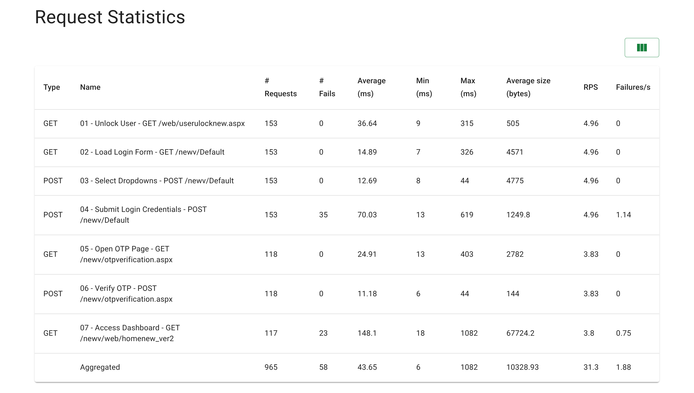
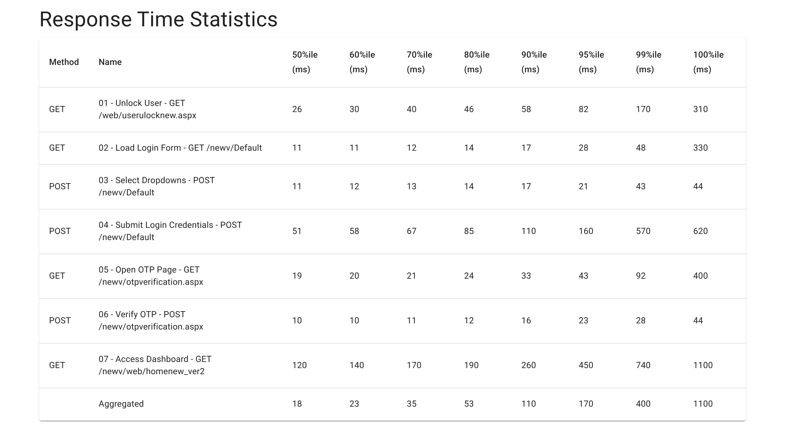

# DNCC e-Revenue Login Flow – Locust Load Test

[](https://www.python.org/)
[](https://locust.io/)
[](#license)

A [Locust](https://locust.io/) load-testing project that simulates the complete **DNCC e-Revenue** user login journey (unlock user → login form → dropdown selection → credentials → OTP → dashboard) and measures response time, throughput and failures.

## Table of Contents

- [About the Project](#about-the-project)
- [Features](#features)
- [Project Structure](#project-structure)
- [Prerequisites](#prerequisites)
- [Installation](#installation)
- [Configuration](#configuration)
- [Running the Test](#running-the-test)
- [Test Scenario](#test-scenario)
- [Latest Test Results](#latest-test-results)
- [Screenshots](#screenshots)
- [Understanding the Report](#understanding-the-report)
- [Troubleshooting](#troubleshooting)
- [Roadmap](#roadmap)
- [Contributing](#contributing)
- [License](#license)

## About the Project

The goal of this project is to check how the DNCC e-Revenue web application behaves when several users go through the login flow at the same time. Each virtual user performs the full seven-step flow, and Locust records the timing and result of every step separately, so slow or failing steps are easy to find.

## Features

- End-to-end login flow, split into 7 named and numbered steps
- Per-step response-time percentiles (50th to 100th)
- Custom failure detection (for example, invalid session or unexpected redirect) using Locust's `catch_response`
- Interactive Web UI mode and headless mode for scripts and CI
- Self-contained HTML report generated after every run


## Prerequisites

- Python 3.9 or newer
- `pip`
- Network access to the target host
- Valid test accounts that you are allowed to use

## Installation

```bash
# 1. Clone the repository
git clone https://github.com/meemmahmuda/DNCC-eRevenue-Load-Test.git
cd DNCC-eRevenue-Load-Test

# 2. (Recommended) create and activate a virtual environment
python -m venv venv
source venv/bin/activate        # Windows: venv\Scripts\activate

# 3. Install dependencies
pip install locust
```

## Configuration

| Setting | Value used in the latest run |
| --- | --- |
| Host | `https://erevenue.dncc.gov.bd` |
| Users (peak) | 10 |
| Spawn rate | about 1 user/second |
| Run time | 30 seconds |


## Running the Test

**Interactive mode (Web UI)**

```bash
locust -f locustfile.py --host https://erevenue.dncc.gov.bd
```

Then open <http://localhost:8089>, enter the number of users and spawn rate, and start the test.

**Headless mode with an HTML report**

```bash
locust -f locustfile.py --host https://erevenue.dncc.gov.bd \
       --headless -u 10 -r 1 -t 30s --html docs/report.html
```

| Flag | Meaning |
| --- | --- |
| `-u` | Peak number of concurrent virtual users |
| `-r` | Users spawned per second |
| `-t` | Total run time |
| `--html` | Path of the generated HTML report |

## Test Scenario

Each virtual user (`DNCCUser`) runs one `login` task, with the steps executed in order:

| # | Step | Request |
| - | ---- | ------- |
| 01 | Unlock User | `GET /web/userulocknew.aspx` |
| 02 | Load Login Form | `GET /newv/Default` |
| 03 | Select Dropdowns | `POST /newv/Default` |
| 04 | Submit Login Credentials | `POST /newv/Default` |
| 05 | Open OTP Page | `GET /newv/otpverification.aspx` |
| 06 | Verify OTP | `POST /newv/otpverification.aspx` |
| 07 | Access Dashboard | `GET /newv/web/homenew_ver2` |

## Latest Test Results

| Item | Value |
| --- | --- |
| Date (UTC) | 2026-11-11, 06:49:16 – 06:49:47 |
| Duration | 31 seconds |
| Peak virtual users | 10 |
| Total requests | 965 |
| Failed requests | 58 (≈ 6.0 %) |
| Throughput | ≈ 31 req/s average, ≈ 35 req/s at steady state |
| Median / 95th / 99th percentile | 18 ms / 170 ms / 400 ms |
| Average / max response time | 43.65 ms / 1082 ms |

### Per-step results

| # | Step | Requests | Failures | Avg (ms) | 95th % (ms) | Max (ms) |
| - | ---- | -------: | -------: | -------: | ----------: | -------: |
| 01 | Unlock User | 153 | 0 | 36.64 | 82 | 315 |
| 02 | Load Login Form | 153 | 0 | 14.89 | 28 | 326 |
| 03 | Select Dropdowns | 153 | 0 | 12.69 | 21 | 44 |
| 04 | Submit Login Credentials | 153 | **35** | 70.03 | 160 | 619 |
| 05 | Open OTP Page | 118 | 0 | 24.91 | 43 | 403 |
| 06 | Verify OTP | 118 | 0 | 11.18 | 23 | 44 |
| 07 | Access Dashboard | 117 | **23** | 148.10 | 450 | 1082 |

### Failures

| Count | Step | Error |
| ----: | ---- | ----- |
| 35 | 04 – Submit Login Credentials | `Login failed: status=200, msg=['alert: Invalid Session / Inappropriate Logout']` |
| 23 | 07 – Access Dashboard | `Session invalid, redirected to: /newv/web/success.aspx` |

### Observations

- All failures are **session-related** (steps 04 and 07). There were no Python exceptions.
- "Invalid Session / Inappropriate Logout" suggests that a session is invalidated when the same account logs in more than once at the same time. If virtual users share one account, using a separate account per user is worth trying.
- The dashboard (step 07) is the heaviest step: about 67 KB per response, average 148 ms, 99th percentile 740 ms.
- Steps 01–03 and 05–06 were fast (average under 40 ms) with no errors at 10 concurrent users.
- The test was short (31 s, 10 users), so treat it as a smoke test, not a capacity measurement.

## Screenshots

### Request statistics


### Response time statistics


### Failures


### Charts (requests per second, response times, users)


Full page: [`docs/screenshots/00-full-report.png`](docs/screenshots/00-full-report.png) · Original report: [`docs/report.html`](docs/report.html)

## Understanding the Report

- **Request Statistics:** request count, failures, average/min/max response time and requests per second for each step.
- **Response Time Statistics:** percentiles. For example, a 95th percentile of 170 ms means 95 % of requests finished within 170 ms.
- **Failures Statistics:** each distinct error with its count and when it was first and last seen.
- **Charts:** requests per second, response times (median and 95th percentile) and number of users over time.
